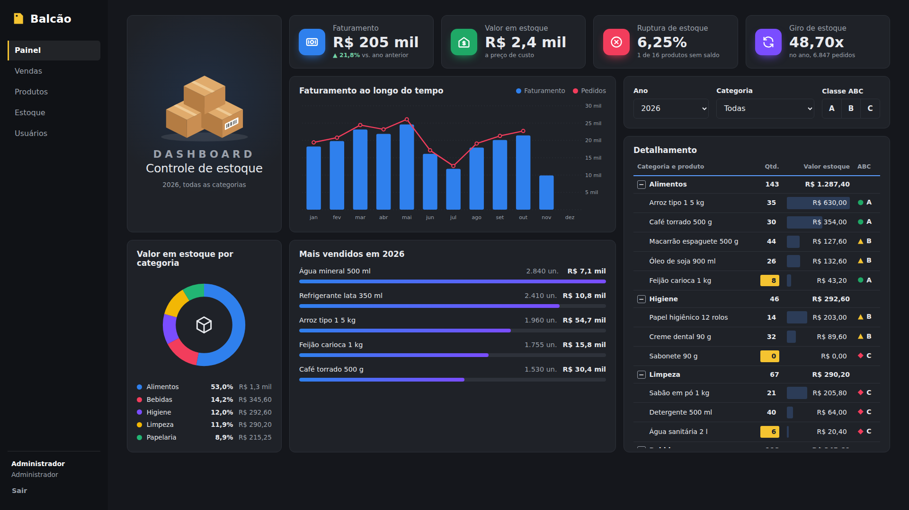
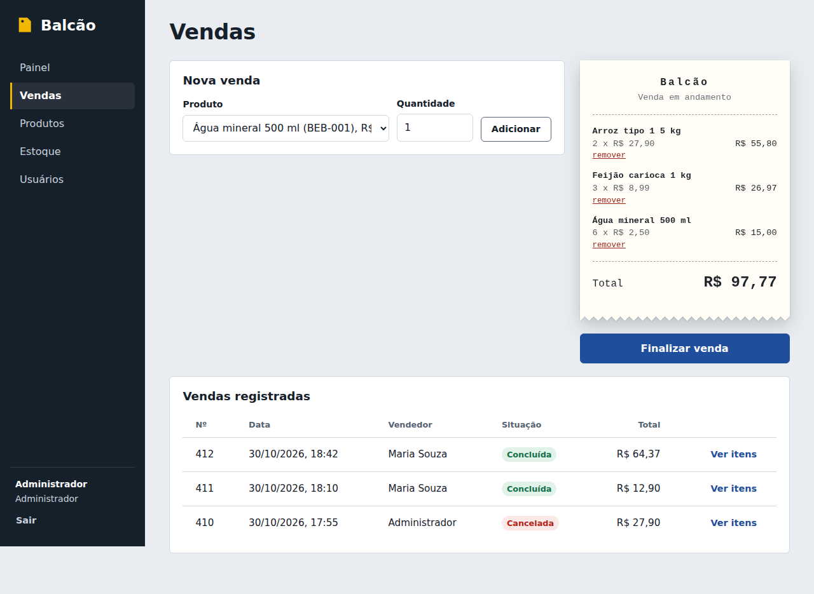
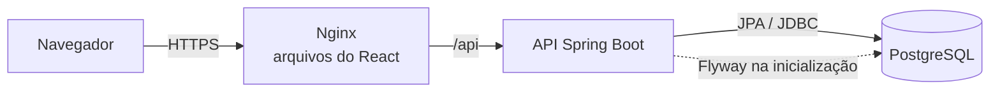

# Balcão: sistema de estoque e vendas

Aplicação web full stack para uma loja controlar produtos, estoque e vendas.
O administrador cadastra produtos e registra entradas e saídas; o vendedor
monta a venda num cupom na tela e finaliza; o painel reúne faturamento,
valor em estoque, ruptura, giro e curva ABC, com filtros por ano e categoria.

| Camada | Tecnologia |
|---|---|
| Frontend | React 18 + Vite, servido por Nginx |
| Backend | Java 21 + Spring Boot 3 (Web, Data JPA, Security, Validation) |
| Banco | PostgreSQL 16 com migrações Flyway |
| Segurança | JWT (jjwt), BCrypt, autorização por perfil |
| Qualidade | JUnit 5, Mockito, AssertJ, JaCoCo, ESLint, Vitest |
| DevOps | Docker multi-stage, Docker Compose, GitHub Actions |





---

## 1. Como executar

### Com Docker (recomendado)

Pré-requisito: Docker com o Compose.

```bash
cp .env.example .env        # depois edite as senhas e o JWT_SECRET
docker compose up --build
```

| Endereço | O que é |
|---|---|
| http://localhost:3000 | Aplicação |
| http://localhost:8080/swagger-ui.html | Documentação interativa da API |
| http://localhost:8080/actuator/health | Saúde da API |

Entre com o `ADMIN_EMAIL` e a `ADMIN_SENHA` definidos no `.env`. Com
`APP_DADOS_DEMO=true`, a primeira execução com o banco vazio cria 16 produtos
e o histórico de vendas desde janeiro do ano anterior, para o painel já ter dados.
Para recriar a demonstração: `docker compose down -v` e suba de novo.

### Em modo de desenvolvimento

Pré-requisitos: Java 21, Maven 3.9, Node 20 e um PostgreSQL rodando.

```bash
# Banco (uma opção rápida)
docker run -d --name estoque-db -p 5432:5432 \
  -e POSTGRES_DB=estoque -e POSTGRES_USER=estoque -e POSTGRES_PASSWORD=estoque postgres:16-alpine

# Backend (porta 8080)
cd backend
export JWT_SECRET="$(openssl rand -base64 48)"
export ADMIN_SENHA="Admin12345"
export APP_DADOS_DEMO=true
mvn spring-boot:run

# Frontend (porta 5173, com proxy de /api para o backend)
cd frontend
npm install
npm run dev
```

### Comandos de qualidade

```bash
cd backend  && mvn verify          # testes + relatório em target/site/jacoco/index.html
cd frontend && npm run lint        # análise estática
cd frontend && npm test            # testes unitários
```

---

## 2. Funcionalidades e perfis

| Funcionalidade | Vendedor | Administrador |
|---|:---:|:---:|
| Ver painel, produtos, vendas e movimentações | ✓ | ✓ |
| Registrar venda | ✓ | ✓ |
| Cancelar venda (devolve os itens ao estoque) | | ✓ |
| Cadastrar, editar e desativar produtos | | ✓ |
| Registrar entrada e saída manual de estoque | | ✓ |
| Cadastrar usuários | | ✓ |

Indicadores do painel:

| Indicador | Como é calculado |
|---|---|
| Faturamento | Soma das vendas concluídas no ano. No ano corrente, a comparação é com o mesmo período do ano anterior (1º de janeiro até a data de hoje); em anos encerrados, com o ano anterior inteiro |
| Valor em estoque | Saldo de cada produto multiplicado pelo preço de custo |
| Ruptura de estoque | Percentual de produtos ativos com saldo zero |
| Giro de estoque | Custo das mercadorias vendidas no ano dividido pelo valor atual em estoque |
| Curva ABC | Produtos ordenados pelo faturamento no ano: A até 80% do acumulado, B até 95%, C o restante |

Regras de negócio principais:
- não é possível vender mais do que o saldo disponível;
- a venda é tudo ou nada: se um item falhar, nenhum estoque é baixado;
- preço e total são sempre calculados no servidor, nunca aceitos do navegador;
- o saldo só muda por movimentação registrada (entrada, saída, venda ou cancelamento).

---

## 3. Arquitetura



O backend segue uma **arquitetura em camadas**, e cada camada só conversa com a de baixo:

```
backend/src/main/java/br/com/estoque/
├── controller/   Recebe HTTP, valida a entrada (@Valid) e devolve DTOs. Sem regra de negócio.
├── service/      Regras de negócio e limites de transação (@Transactional).
├── repository/   Acesso a dados com Spring Data JPA (consultas parametrizadas).
├── domain/       Entidades JPA com comportamento (ex.: Produto.baixarEstoque).
├── dto/          Records de entrada e saída: a API nunca expõe entidades nem hashes.
├── security/     Geração e validação de JWT e o filtro de autenticação.
├── config/       Spring Security, CORS, OpenAPI e carga inicial de dados.
└── exception/    Exceções de negócio e o tratador global de erros.
```

O frontend separa interface de lógica:

```
frontend/src/
├── paginas/      Uma tela por arquivo (Painel, Vendas, Produtos, Estoque, Usuários, Login).
├── componentes/  Peças reutilizáveis (Modal, Paginação, Etiqueta, Aviso, Layout).
├── servicos/     Cliente HTTP, formatação pt-BR e regras do carrinho (testáveis sem tela).
└── contexto/     Estado de autenticação compartilhado.
```

Principais decisões:
- **API REST** com recursos no plural, verbos HTTP corretos e códigos de status
  significativos (201, 204, 400, 401, 403, 404, 409, 422).
- **Stateless**: nenhum estado de sessão no servidor; a API pode ganhar mais instâncias.
- **Mesmo domínio**: o Nginx serve o React e repassa `/api`, o que dispensa CORS em produção.
- **Paginação** em todas as listagens, com tamanho máximo de 100 itens por página.

---

## 4. Modelo de dados

Seis tabelas: `usuarios`, `categorias`, `produtos`, `vendas`, `itens_venda` e
`movimentacoes_estoque`. O diagrama entidade-relacionamento e as decisões
(normalização, preço congelado, auditoria, concorrência) estão em
[docs/modelo-de-dados.md](docs/modelo-de-dados.md).

---

## 5. Segurança da informação

| Risco | Medida adotada |
|---|---|
| Vazamento de senhas | Hash **BCrypt** com custo 12; a senha nunca é gravada nem devolvida |
| Acesso indevido | **JWT** assinado (HMAC-SHA256) com emissor e expiração validados |
| Escalada de privilégio | Autorização por perfil com `@PreAuthorize` em cada operação sensível; a tela esconde botões, mas quem decide é a API |
| Usuário desligado | O filtro recarrega o usuário a cada requisição: desativado, o token perde efeito na hora |
| Descobrir e-mails cadastrados | Login devolve a mesma mensagem para e-mail inexistente e senha errada |
| SQL Injection | Somente JPQL/consultas derivadas com parâmetros; nenhuma concatenação de SQL |
| Dados malformados | Bean Validation em todos os DTOs (tamanhos, formatos, faixas) e `CHECK` no banco |
| Adulteração de preço | O cliente envia só produto e quantidade; preço e total são calculados no servidor |
| Vazamento de detalhes internos | Tratador global devolve mensagens padronizadas; stack trace só no log |
| Segredos no código | Senhas, JWT e credenciais vêm de variáveis de ambiente; a API não sobe sem `JWT_SECRET` com 32+ caracteres; `.env` está no `.gitignore` |
| XSS e clickjacking | React escapa o conteúdo por padrão; Nginx envia CSP, `X-Frame-Options`, `nosniff` e `Referrer-Policy` |
| Exposição do banco | O PostgreSQL não publica porta: só a API o alcança pela rede interna do Docker |
| Contêiner comprometido | A API roda com usuário sem privilégios de root |
| Venda dupla do mesmo saldo | Trava de linha (`FOR UPDATE`) e controle otimista (`@Version`) |

---

## 6. Engenharia de software e qualidade de código

- **Princípios**: responsabilidade única por classe, injeção de dependência por
  construtor, regras de negócio dentro das entidades (`Produto`, `Venda`) em vez de
  espalhadas nos controllers.
- **Nomes de domínio em português**, consistentes do banco até a tela.
- **Testes automatizados**:
  - `ProdutoTest`: regras de saldo, estoque mínimo e preço congelado no item;
  - `VendaServiceTest` (Mockito): cálculo do total, baixa de estoque, junção de itens
    repetidos, estoque insuficiente, produto inativo e cancelamento;
  - `JwtServiceTest`: token válido, assinado com outra chave, expirado e segredo fraco;
  - `CurvaAbcTest`: classificação A, B e C pela participação acumulada no faturamento;
  - `DashboardServiceTest`: faturamento, comparação com o mesmo período do ano anterior, ruptura, giro, ranking e filtro por categoria;
  - `carrinho.test.js` e `formato.test.js` (Vitest): total sem erro de arredondamento,
    limite de estoque, conversão e abreviação de valores no formato brasileiro.
- **Cobertura** medida pelo JaCoCo a cada `mvn verify`.
- **Análise estática** com ESLint (incluindo as regras de hooks do React); o CI falha com qualquer aviso.
- **Padronização** de formatação via `.editorconfig`.

---

## 7. DevOps e gestão de configuração

- **Versionamento**: Git, com `.gitignore` para artefatos e segredos. Sugestão de
  fluxo: branch `main` protegida, trabalho em branches `feature/...` e merge por
  pull request com o CI aprovado. Mensagens no padrão Conventional Commits
  (`feat:`, `fix:`, `docs:`, `test:`).
- **Banco versionado**: cada mudança de esquema é uma nova migração
  (`V3__...sql`); migrações já aplicadas nunca são editadas.
- **Configuração externa** (12-factor): tudo o que muda entre ambientes vem de
  variáveis de ambiente, com o modelo documentado em `.env.example`.
- **Imagens Docker multi-stage**: a imagem final da API tem só o JRE; a do frontend, só o Nginx com os arquivos gerados.
- **Docker Compose** com `healthcheck`: a API só sobe depois que o banco está pronto.
- **Pipeline de CI** (`.github/workflows/ci.yml`) a cada push e pull request:
  1. backend: compila, roda os testes e publica a cobertura;
  2. frontend: lint, testes e build de produção;
  3. docker: constrói as imagens, só se os dois anteriores passarem.
- **Observabilidade básica**: `/actuator/health` usado pelo healthcheck do contêiner.

---

## 8. Endpoints da API

Todos exigem `Authorization: Bearer <token>`, exceto o login. A lista completa,
com exemplos, está no Swagger.

| Método | Caminho | Perfil | Descrição |
|---|---|---|---|
| POST | `/api/auth/login` | público | Autentica e devolve o token |
| GET | `/api/auth/me` | todos | Dados do usuário logado |
| GET | `/api/dashboard?ano=&categoriaId=` | todos | Indicadores, séries e detalhamento do painel |
| GET | `/api/produtos?termo=&page=&size=` | todos | Lista paginada com busca |
| GET | `/api/produtos/estoque-baixo` | todos | Produtos no mínimo ou abaixo |
| GET | `/api/produtos/{id}` | todos | Detalhe do produto |
| POST | `/api/produtos` | admin | Cadastra produto |
| PUT | `/api/produtos/{id}` | admin | Atualiza cadastro |
| DELETE | `/api/produtos/{id}` | admin | Desativa produto |
| GET | `/api/categorias` | todos | Lista categorias |
| POST | `/api/categorias` | admin | Cria categoria |
| GET | `/api/estoque/movimentacoes?produtoId=` | todos | Histórico de movimentações |
| POST | `/api/estoque/movimentacoes` | admin | Registra entrada ou saída |
| GET | `/api/vendas` | todos | Lista paginada de vendas |
| GET | `/api/vendas/{id}` | todos | Venda com itens |
| POST | `/api/vendas` | todos | Registra venda |
| POST | `/api/vendas/{id}/cancelamento` | admin | Cancela e devolve ao estoque |
| GET | `/api/usuarios` | admin | Lista usuários |
| POST | `/api/usuarios` | admin | Cadastra usuário |

Exemplo de venda:

```bash
curl -X POST http://localhost:8080/api/vendas \
  -H "Authorization: Bearer $TOKEN" -H "Content-Type: application/json" \
  -d '{"itens":[{"produtoId":1,"quantidade":2},{"produtoId":4,"quantidade":6}]}'
```

Formato padrão de erro:

```json
{
  "status": 422,
  "erro": "Unprocessable Entity",
  "mensagem": "Estoque insuficiente para Feijão carioca 1 kg: disponível 1, solicitado 2",
  "detalhes": [],
  "momento": "2026-10-30T15:42:10-03:00"
}
```

---

## 9. Próximos passos possíveis

- Testes de integração com Testcontainers (PostgreSQL real no CI).
- Limite de tentativas de login (rate limiting) e troca de senha pelo próprio usuário.
- Token em cookie `HttpOnly` com refresh token.
- Exportação do painel e do detalhamento para Excel.
- Deploy contínuo (CD) para um ambiente de homologação.
