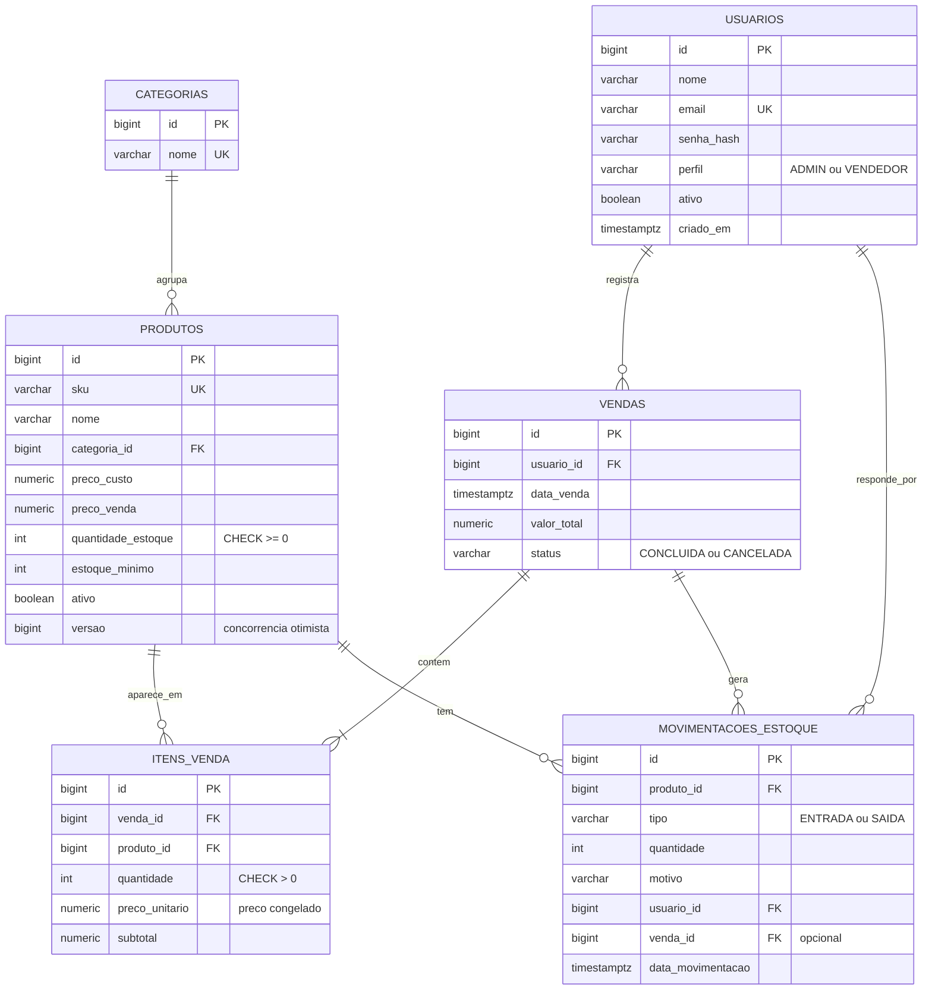

# Modelo de dados

Banco relacional PostgreSQL, com o esquema versionado por migrações do Flyway
(`backend/src/main/resources/db/migration`). O Hibernate roda em modo `validate`:
ele confere se as entidades batem com o banco, mas nunca altera tabelas sozinho.

## Decisões de modelagem

**Normalização (3FN).** Categoria é uma tabela própria, e cada venda tem seus itens
em `itens_venda`, em vez de repetir dados do produto dentro da venda.

**Preço congelado no item.** `itens_venda.preco_unitario` guarda o preço do momento
da venda. Se o preço do produto mudar depois, o histórico continua correto. É uma
desnormalização proposital, porque o dado tem significado histórico.

**Trilha de auditoria.** O saldo (`produtos.quantidade_estoque`) só muda junto com
um registro em `movimentacoes_estoque`, que diz quem mexeu, quando e por quê.
A soma das entradas menos as saídas de um produto sempre bate com o saldo.

**Exclusão lógica.** Produtos e usuários são desativados (`ativo = false`), nunca
apagados, para não quebrar as chaves estrangeiras de vendas antigas.

**Integridade no próprio banco.** `CHECK` impede saldo negativo, preço negativo e
quantidade zero; índices únicos em `lower(email)`, `lower(sku)` e `lower(nome)`
impedem duplicados que diferem só em maiúsculas e minúsculas.

**Valores monetários.** `NUMERIC(12,2)` no banco e `BigDecimal` no Java: nada de
`double` para dinheiro.

**Índices.** Além das chaves, há índices para as consultas mais frequentes:
vendas por data (painel do mês), itens por venda e por produto, e movimentações
por produto ordenadas por data.

**Concorrência.** Duas proteções trabalham juntas:
- a venda trava as linhas dos produtos com `SELECT ... FOR UPDATE`, sempre na
  mesma ordem (por id), o que evita vender o mesmo saldo duas vezes e evita deadlock;
- a coluna `versao` (`@Version`) faz uma edição de cadastro falhar com erro 409 se
  o produto tiver sido alterado no meio do caminho, em vez de sobrescrever o saldo.
